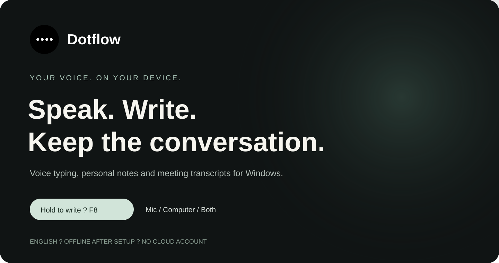
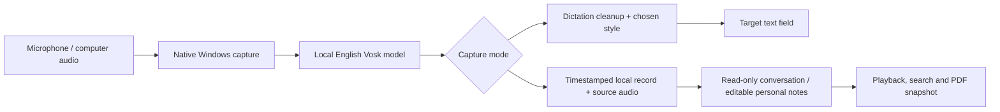

<p align="center"></p>

# Dotflow

**Speak. Write. Keep the conversation.**

Private voice typing, personal notes and meeting transcripts for Windows. Hold your shortcut to write, or capture microphone audio, computer output, or both into a local notebook.



[Get started](#get-started) ? [Features](#three-ways-to-capture) ? [How it works](#how-it-works) ? [Privacy](#your-data-stays-on-your-device) ? [User guide](USER_GUIDE.md) ? [Project story](https://myhai.org/project.html?project=dotflow)

| Platform | Speech | Runtime | Current version |
|---|---|---|---|
| Windows 10/11 x64 | English, local Vosk | Native C# / .NET Framework 4.8 | 0.7.0 preview |

## Why Dotflow?

Writing and remembering a conversation are different jobs. Dotflow brings both into a small desktop app: dictate into a text field, capture a thought without keeping the main window open, or save a meeting with the original conversation separate from your own notes.

The project started with a shortcut-driven dictation tool and grew into a native Windows application with an edge toolbar, selectable audio sources, local playback, and view-oriented PDF exports. Speech runs on your computer after the first setup download. No Docker, Python installation, cloud API key or account is needed to use the app.

## Three ways to capture

| Workflow | What you do | What you keep |
|---|---|---|
| **Voice typing** | Focus a text field, hold F8 or your chosen combination, speak, then release. | Refined text inserted into the target app; optional live writing. |
| **Personal notes** | Start from Home, the edge toolbar or the note toggle shortcut. Press again to stop. | A local record with editable details and your own notes. |
| **Meeting transcripts** | Choose microphone, computer output or both, then record and pause/resume as needed. | Timestamped conversation and separate source audio tracks. |

### Write in your own style

Choose **Standard**, **Chat**, **Email** or conservative **Code** formatting. Turn cleanup off for verbatim writing. Save names, vocabulary and spoken snippets with a searchable editor; explicitly remember a correction when you want it reused. These rules affect dictation, never the original recorded conversation.


### Keep the original conversation

Search saved notes by content, title, names and tags. Review timestamp/source blocks, play available audio tracks, seek and change playback speed. Correct speaker labels while preserving the spoken words. Titles and participant details inferred from introductions remain editable.

The local review tools organize source quotes and find related statements using keywords. They do not perform semantic AI summarization or automatic speaker diarization.

### Share a PDF snapshot

Preview **Conversation only**, **Personal notes only** or **Full record**, then save a searchable PDF. Participant/speaker labels are optional; spoken names remain in the text. The export UI offers PDF only, keeping editable data formats out of the conversation-sharing flow.


Original conversations are read-only inside Dotflow. An exported PDF is a copy: external tools can change it, and it is not digitally signed or tamper-proof evidence. Screenshots above use isolated demonstration data.

### Stay out of the way

A slim edge toolbar reveals icons on hover, with names on each icon. Drag it to any screen edge; orientation follows the edge. Use Light, Dark or System theme, reduced motion, optional recording animation, permanent hide or a one-hour snooze. Shortcuts are configurable, and notes use a toggle rather than requiring you to keep a key held.

## Get started

1. **Get the source** from this repository, or check [GitHub Releases](https://github.com/sudheer-050/dotflow/releases) for available installer assets. The 0.7.0 source is available; a hosted 0.7.0 installer has not been verified here.
2. **Build the installer** on Windows if you are using the source:

   ```powershell
   .\scripts\build_setup.ps1
   ```

3. Run `dist/Dotflow-Setup-0.7.0.exe`. It is a small bootstrapper, not the entire installed package. First installation needs internet for the pinned native runtime and approximately 40 MB English speech model; setup verifies hashes and tests model loading.
4. Open Dotflow, complete the microphone and Practice checks, then confirm that dictation appears in another app. Speech can run offline afterwards.

**Requirements:** Windows 10/11 x64, .NET Framework 4.8, microphone permission for microphone capture, and an output device for system audio. No macOS, Android or iOS build is supplied. The preview installer is unsigned; there is no configured signed automatic-update feed. Review the source and release hashes before choosing to install it.

For terminal input, select Auto, Ctrl+Shift+V or Shift+Insert in Writing preferences as appropriate for your terminal. Dotflow does not send Enter. Held modifier combinations can delay live insertion until release.

## How it works



| Layer | Implementation |
|---|---|
| Desktop interface | C# WinForms, native keyboard and tray integration |
| Speech recognition | Small English Vosk model, local inference |
| Audio | Windows microphone capture and WASAPI output capture |
| Persistence | Local note metadata, transcripts and WAV tracks |
| Export | Searchable, tagged Unicode PDF with scope preview |
| Installation | Windows bootstrapper with pinned component hashes |

## Your data stays on your device

- Speech recognition uses local model files. Setup downloads components; update checks are optional.
- Dictation audio stays in memory. The latest failed dictation may be retried, copied or discarded; recovery ends when the app exits.
- Notes deliberately save audio and text under `%LOCALAPPDATA%\LocalDictation\Notes`. Internal names are preserved for upgrade compatibility.
- Recording computer output captures all apps using the selected output device. Choose the device used by your call and use headphones to reduce duplicated audio. Record only with the appropriate participants' consent.
- Recently deleted recovery, explicit permanent deletion, opt-in retention and ZIP backup/restore help manage saved records. Backups contain active notes, not preferences, deleted records or speech components.

## Verification and current limits

**84 automated checks passed; four live checks were excluded** in the 0.7.0 verification run. Coverage includes isolated UX flows, Cancel behavior, original-word preservation, export scope, PDF structure, backup/import safety, setup hashes and native-engine lifetime. See the [full implementation report](FIX_REPORT_0.7.0.md) for the disposition of all 38 review findings.

The current model is deliberately small. Quiet speech, proper names, overlapping speakers and long meetings still need a consented accuracy corpus. Quiet-noise suppression is a signal-level gate; it can miss quiet speech or retain loud non-speech. Real browser/terminal insertion, call capture, mixed-DPI monitors and Narrator require normal desktop acceptance. No measured Wispr accuracy or latency comparison is claimed.

## Development

```powershell
git clone https://github.com/sudheer-050/dotflow.git
cd dotflow
.\scripts\build_setup.ps1
```

Builds use the installed Windows .NET compiler. Python is needed only for the optional development tests, not the app. See [requirements-dev.txt](requirements-dev.txt). Preserve existing user data when testing; diagnostic fixtures should use isolated directories.

## Explore the project

- [User guide](USER_GUIDE.md): shortcuts, audio selection, playback and storage.
- [Release notes](RELEASE_NOTES.md): what changed in 0.7.0.
- [Fix report](FIX_REPORT_0.7.0.md): implementation evidence and outstanding acceptance work.
- [Third-party notices](THIRD_PARTY_NOTICES.md): included components and their licenses.
- [Report an issue](https://github.com/sudheer-050/dotflow/issues): include your Windows version, capture mode and steps to reproduce; keep private recordings out of public issues.

Built by [Sudheer Kumar Gandiboyana](https://github.com/sudheer-050).
