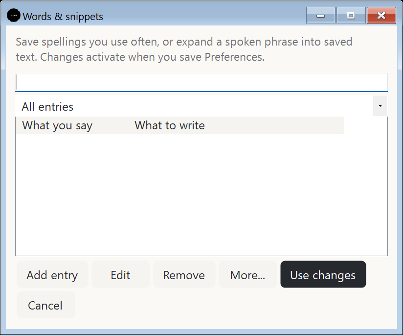
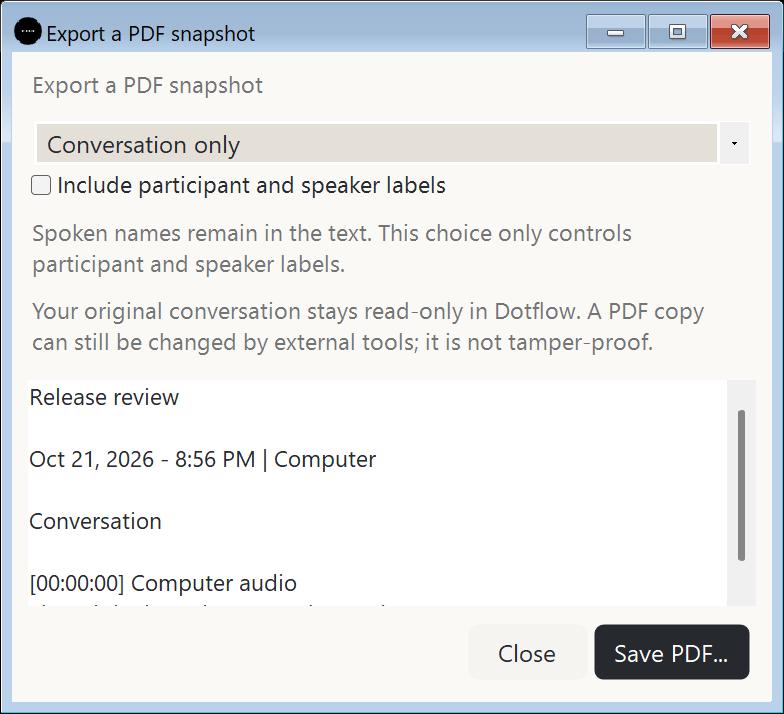
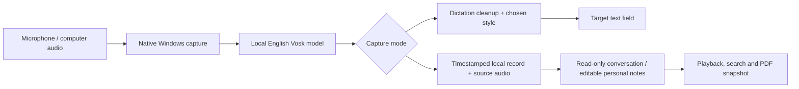

<p align="center"></p>

# Notewll

**Speak. Write. Keep the conversation.**

Private voice typing, personal notes and meeting transcripts for Windows. Hold your shortcut to write, or capture microphone audio, computer output, or both into a local notebook.


[Get started](#get-started) | [Features](#three-ways-to-capture) | [How it works](#how-it-works) | [Privacy](#your-data-stays-on-your-device) | [User guide](USER_GUIDE.md) | [Project story](https://myhai.org/projects/dotflow/)

| Platform | Speech | Runtime | Current version |
|---|---|---|---|
| Windows 10/11 x64 | English, local Vosk | Native C# / .NET Framework 4.8 | 0.8.1 local candidate |

## Why Notewll?

Writing and remembering a conversation are different jobs. Notewll brings both into a small desktop app: dictate into a text field, capture a thought without keeping the main window open, or save a meeting with the original conversation separate from your own notes.

The project started with a shortcut-driven dictation tool and grew into a native Windows application with an edge toolbar, selectable audio sources, local playback, and view-oriented PDF exports. The single-file installer includes the standard English speech engine and model; speech runs on your computer without an installation download. No Docker, Python installation, cloud API key or account is needed to use the app.

## Three ways to capture

| Workflow | What you do | What you keep |
|---|---|---|
| **Voice typing** | Focus a text field, hold F8 or your chosen combination, speak, then release. | Refined text inserted into the target app; optional live writing. |
| **Personal notes** | Start from Home, the edge toolbar or the note toggle shortcut. Press again to stop. | A local record with editable details and your own notes. |
| **Meeting transcripts** | Choose microphone, computer output or both, then record and pause/resume as needed. | Timestamped conversation and separate source audio tracks. |

### Write in your own style

Choose **Standard**, **Chat**, **Email** or conservative **Code** formatting. Turn cleanup off for verbatim writing. Save names, vocabulary and spoken snippets with a searchable editor; explicitly remember a correction when you want it reused. These rules affect dictation, never the original recorded conversation.



### Keep the original conversation

Search saved notes by content, title, names and tags. Review timestamp/source blocks, play available audio tracks, seek and change playback speed. Correct speaker labels while preserving the spoken words. Titles and participant details inferred from introductions remain editable.

The local review tools organize source quotes and find related statements using keywords. They do not perform semantic AI summarization or automatic speaker diarization.

### Share a PDF snapshot

Preview **Conversation only**, **Personal notes only** or **Full record**, then save a searchable PDF. Participant/speaker labels are optional; spoken names remain in the text. The export UI offers PDF only, keeping editable data formats out of the conversation-sharing flow.



Original conversations are read-only inside Notewll. An exported PDF is a copy: external tools can change it, and it is not digitally signed or tamper-proof evidence. Screenshots above use isolated demonstration data.

### Stay out of the way

Click the compact floating ball to reveal a half-circle of action icons. Each icon sits on a translucent white round tile. Drag and release the ball to throw it: gravity, bouncing and rolling friction bring it to rest at the bottom edge.

Preferences > Ball offers sports and planet skins, plain Color or Gradient appearances, live color-range previews, and nine independent gravity environments. Closed and expanded sizes have separate percentage sliders; icon tiles scale with the expanded size. Add an image from a local folder to rotate with the ball. Gravity choices automatically demonstrate a sample bounce. Reduced motion, optional recording animation, permanent hiding and one-hour snoozing remain available.

## Get started

1. **Download the installer** from [GitHub Releases](https://github.com/sudheer-050/notewll/releases). Choose **Notewll-Setup.exe** when the new offline package is published. This package is currently prepared locally; publication is pending.
2. Double-click **Notewll-Setup.exe**, click **Install**, then **Open app**. Developers using the source can build it on Windows:

   ```powershell
   .\scripts\build_setup.ps1
   ```

3. Share or run `dist/Notewll-Setup.exe` (about 56 MB). This single installer includes the app, standard offline English speech runtime and model, Start menu shortcut and uninstaller. Click Install; no internet, Python or setup scripts are required. Setup verifies the included archives and tests model loading.
4. Open Notewll, complete the microphone check and try dictation on Home, then confirm that dictation appears in another app. Speech can run offline afterwards.

**Requirements:** Windows 10/11 x64, .NET Framework 4.8, microphone permission for microphone capture, and an output device for system audio. No macOS, Android or iOS build is supplied. The preview installer is unsigned; there is no configured signed automatic-update feed. Review the source and release hashes before choosing to install it.

For terminal input, select Auto, Ctrl+Shift+V or Shift+Insert in Writing preferences as appropriate for your terminal. Notewll does not send Enter. Held modifier combinations can delay live insertion until release.

### Updates

Download the newest installer from [GitHub Releases](https://github.com/sudheer-050/notewll/releases) and run it again. Setup preserves your notes, recordings and preferences. About > Check for updates opens GitHub Releases when no signed update feed is configured. Automatic download and installation require a configured trusted publisher certificate and HTTPS update feed.

## How it works



| Layer | Implementation |
|---|---|
| Desktop interface | C# WinForms, native keyboard and tray integration |
| Speech recognition | Small English Vosk model, local inference |
| Audio | Windows microphone capture and WASAPI output capture |
| Persistence | Local note metadata, transcripts and WAV tracks |
| Export | Searchable, tagged Unicode PDF with scope preview |
| Installation | Windows bootstrapper with pinned component hashes |

## Your data stays on your device

- Speech recognition uses local model files. The installer includes standard speech components; update checks are optional.
- Dictation audio stays in memory. The latest failed dictation may be retried, copied or discarded; recovery ends when the app exits.
- Notes deliberately save audio and text under `%LOCALAPPDATA%\LocalDictation\Notes`. Internal names are preserved for upgrade compatibility.
- Recording computer output captures all apps using the selected output device. Choose the device used by your call and use headphones to reduce duplicated audio. Record only with the appropriate participants' consent.
- Recently deleted recovery, explicit permanent deletion, opt-in retention and ZIP backup/restore help manage saved records. Backups contain active notes, not preferences, deleted records or speech components.

## Accurate local dictation

The optional 0.8.1 accuracy setup uses Parakeet TDT 0.6B v2 on CPU and a local neural speech detector. It recognizes while you speak and uses the recognizer's own punctuation plus conservative formatting and filler removal. Shortcut typing, Practice, audio-file checks and recovery use the selected dictation engine. They do not wait for a separate Ollama grammar service.

Run `scripts/setup_accuracy.ps1` from normal PowerShell to prepare the Python environment, pinned local model and checked installation. A new computer needs an initial model download of about 2.5 GB; inference thereafter stays offline. Wait for Ready before using the shortcut. Basic mode retains the small Vosk model without these optional dependencies. Enhanced meeting recognition/voice grouping is a separate preference prepared by `scripts/setup_quality.ps1`; accurate dictation alone does not require those meeting dependencies.

The new gate returned no words for 21 synthetic non-speech controls. Thirteen speech replays finished in 18-2,077 ms after simulated release, including any in-flight recognition; twelve finished under one second. These are limited replay measurements, not physical shortcut-to-insertion timings or a universal latency/accuracy guarantee. Human-verified accuracy is still pending. See [accuracy implementation and verification](verification/ACCURACY_0.8.1.md).

## Verification and current limits

The current verification record is in [ACCURACY_0.8.1.md](verification/ACCURACY_0.8.1.md). Unit and integration checks do not establish word error rate. `scripts/score_accuracy.py` scores only explicitly reviewed references; release publication now requires its gate to pass. Existing history/model predictions are not silently accepted as ground truth. The historical [0.7.0 implementation report](FIX_REPORT_0.7.0.md) covers the original UX review.

The current model is deliberately small. Quiet speech, proper names, overlapping speakers and long meetings still need a consented accuracy corpus. Quiet-noise suppression is a signal-level gate; it can miss quiet speech or retain loud non-speech. Real browser/terminal insertion, call capture, mixed-DPI monitors and Narrator require normal desktop acceptance. No measured Wispr accuracy or latency comparison is claimed.

## Development

```powershell
git clone https://github.com/sudheer-050/notewll.git
cd notewll
.\scripts\build_setup.ps1
```

Builds use the installed Windows .NET compiler. Python is needed only for the optional development tests, not the app. See [requirements-dev.txt](requirements-dev.txt). Preserve existing user data when testing; diagnostic fixtures should use isolated directories.

## Explore the project

- [User guide](USER_GUIDE.md): shortcuts, audio selection, playback and storage.
- [Release notes](RELEASE_NOTES.md): what changed in 0.7.0.
- [Fix report](FIX_REPORT_0.7.0.md): implementation evidence and outstanding acceptance work.
- [Third-party notices](THIRD_PARTY_NOTICES.md): included components and their licenses.
- [Report an issue](https://github.com/sudheer-050/notewll/issues): include your Windows version, capture mode and steps to reproduce; keep private recordings out of public issues.

Built by [Sudheer Kumar Gandiboyana](https://github.com/sudheer-050).
